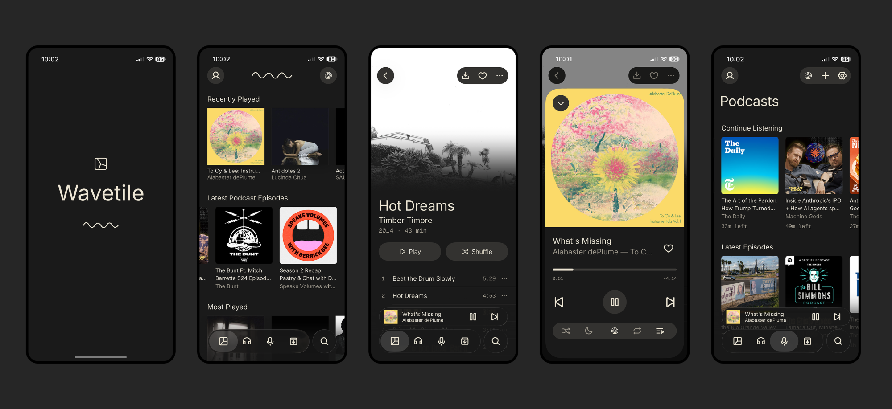

# Wavetile

**Wavetile is a native iPhone client for Jellyfin with a podcast player built in.** 

**Public beta:** [join on TestFlight](https://testflight.apple.com/join/pk9dyfMq) · [wavetile.com](https://wavetile.com)

You need a Jellyfin server with a music library. Wavetile collects no data: no account, no analytics, no tracking ([privacy policy](https://wavetile.com/privacy)). Bug reports and feature ideas are welcome in [Issues](https://github.com/derrellwilliams/wavetile/issues).

## Features
| Area | What |
|---|---|
| Sign in | Server address or Quick Connect; token kept in the Keychain |
| Library | Full sync into a local GRDB mirror (fast and works offline): albums, artists, songs, genres, playlists, collections, favorites, search |
| Home | Recently Played, Most Played, Recently Added, From Your Library, Artist Spotlight; a welcome card plus genre and playlist shelves for new listeners |
| Playback | Gapless queue, shuffle/repeat, lock screen and Control Center controls, Start Radio (Jellyfin Instant Mix) |
| Downloads | Background downloads of albums and playlists (MP3 256 kbps by default, or the original file) |
| Podcasts | Opt-in in Settings: directory search, follow by URL or OPML, chapters, transcripts, episode downloads, subscriptions synced through Jellyfin |
| System | Now Playing and Recently Played widgets, download Live Activity, Siri, CarPlay |
| Themes | Dark (default) and Light |

## License
Wavetile is free and open source under the [Mozilla Public License 2.0](LICENSE).

Not covered by that license:
- Fonts: Familjen Grotesk, Stack Sans Notch and Stack Sans Headline are under the SIL Open Font License (license files sit next to the fonts).
- Icons: [Phosphor](https://phosphoricons.com) (MIT).
- Album and podcast artwork in screenshots belongs to its owners.

Built with [jellyfin-sdk-swift](https://github.com/jellyfin/jellyfin-sdk-swift), [GRDB](https://github.com/groue/GRDB.swift), [Nuke](https://github.com/kean/Nuke) and [Inject](https://github.com/krzysztofzablocki/Inject). Wavetile is an independent app, not affiliated with the Jellyfin project.
